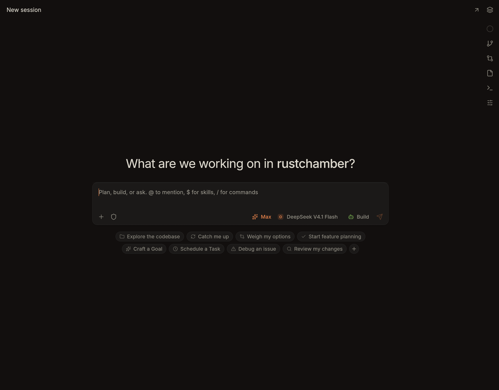
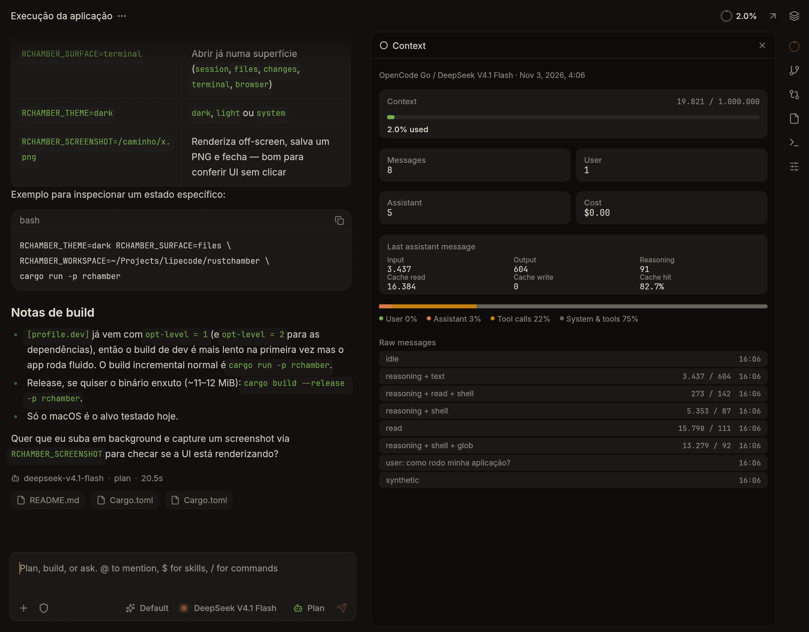
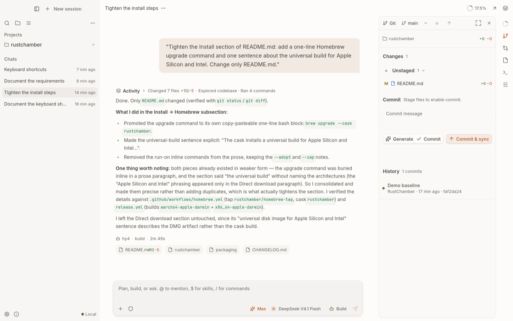
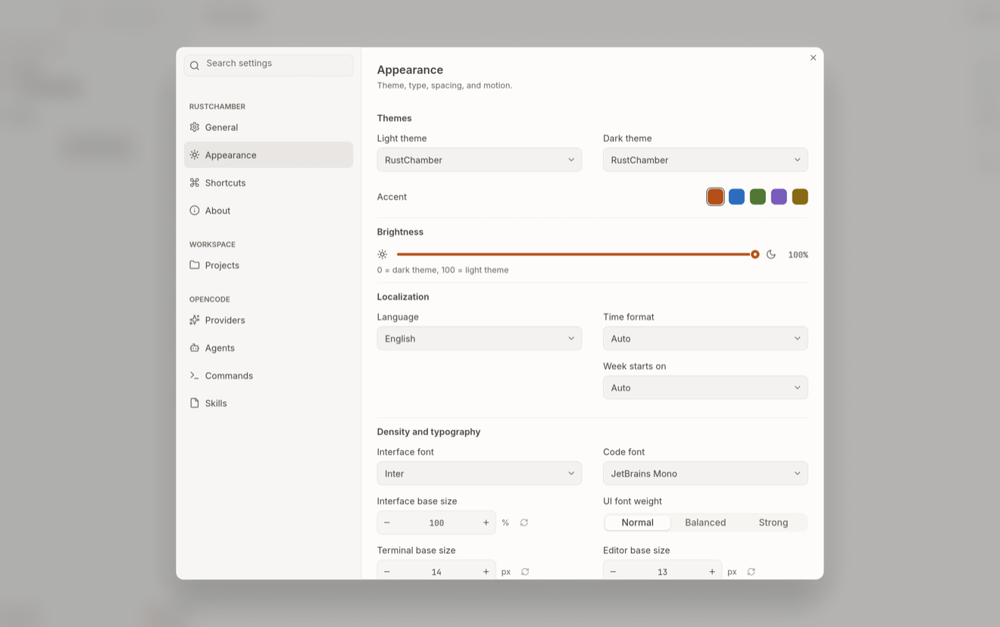
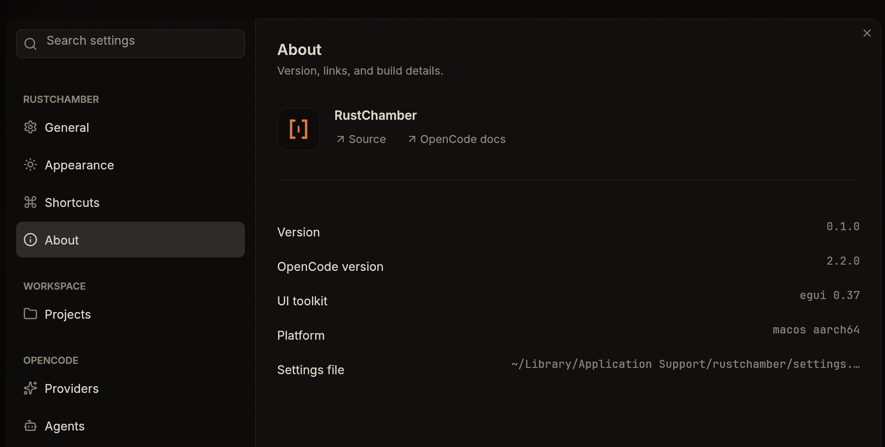

<p align="center">
  
</p>

# RustChamber

A native desktop workspace for [OpenCode](https://opencode.ai), written in Rust with
`egui`. There is no webview, no Electron, and no JavaScript runtime.

RustChamber talks to the OpenCode server directly over HTTP and Server-Sent Events. Chat,
terminal, files, changes, and git live in the same window, with a keyboard-first interface
built for long sessions. Projects are explicit: a fresh install starts empty, and only the
projects and sessions you create from RustChamber are shown.

[rustchamber.lipecode.com](https://rustchamber.lipecode.com) — download, support, and roadmap.



## Install

### Homebrew

```bash
brew install --cask rustchamber/tap/rustchamber
```

The cask installs the universal build and clears the macOS quarantine flag, so the app
opens without the "Apple could not verify" dialog. If you already installed RustChamber
from the DMG, adopt it once with
`brew install --cask --adopt rustchamber/tap/rustchamber`. Upgrade with
`brew upgrade --cask rustchamber`; remove settings as well with
`brew uninstall --zap --cask rustchamber`.

### Direct download

macOS builds are published on the [Releases](https://github.com/rustchamber/rustchamber/releases)
page as a universal disk image for Apple Silicon and Intel.

1. Download `RustChamber-<version>-macos-universal.dmg`.
2. Open the image and drag RustChamber to Applications.
3. Install the [OpenCode CLI](https://opencode.ai/docs) and make sure `opencode` is on your
   `PATH`.

Builds are ad-hoc signed unless Apple Developer credentials are configured. A direct
download is quarantined by macOS, so the first launch is blocked; open System Settings →
Privacy & Security and choose **Open Anyway**. If the app is reported as damaged, clear the
quarantine flag:

```bash
xattr -dr com.apple.quarantine /Applications/RustChamber.app
```

### Linux

Linux x86_64 builds are published on the same [Releases](https://github.com/rustchamber/rustchamber/releases)
page. The portable build needs glibc 2.31 or newer, which covers Ubuntu 20.04+, Debian 11+,
Fedora 32+, RHEL 9+, openSUSE Leap 15.3+, and current Arch Linux. Pick the package for your
distribution:

```bash
# Debian / Ubuntu / Linux Mint / Pop!_OS
sudo apt install ./RustChamber-*-linux-x86_64.deb

# Fedora / RHEL / Rocky / AlmaLinux
sudo dnf install ./RustChamber-*-linux-x86_64.rpm

# openSUSE
sudo zypper install ./RustChamber-*-linux-x86_64.rpm

# Arch / Manjaro / EndeavourOS
sudo pacman -U ./RustChamber-*-linux-x86_64.pkg.tar.zst
```

The native packages install `/usr/bin/rchamber`, the desktop entry, the hicolor icons, and
the AppStream metadata, and declare the X11/Wayland/OpenGL dependencies so the package
manager pulls them in. Updates for these installs go through the package manager; the
in-app updater opens the release page instead of replacing a system file.

The tarball remains available for other distributions and for installs without root:

1. Download `RustChamber-<version>-linux-x86_64.tar.gz`.
2. Extract it and run `./install.sh`. It installs to `~/.local` and needs no sudo.
   Running `./rchamber` from the extracted folder works too. Set `PREFIX=/usr/local` to
   install somewhere else, and pass `--uninstall` to remove it.
3. Install the [OpenCode CLI](https://opencode.ai/docs). RustChamber requires OpenCode 2.x
   and looks for `opencode` in `PATH`, `~/.opencode/bin`, `~/.local/bin`, the OpenChamber
   bundled CLI, and other common locations. If you have both OpenCode 1 and 2 installed,
   set `RCHAMBER_OPENCODE_BIN` to the 2.x binary.

The tarball includes the desktop entry, hicolor icons, AppStream metadata, and
`check-deps.sh`, which prints the exact install command for the detected distribution when
an X11, Wayland, OpenGL, or fontconfig library is missing. Opening files and links needs
`xdg-open` from `xdg-utils`; the native packages install it automatically.

### Flatpak (Flathub)

The Flatpak manifest lives in `packaging/flatpak/` and is prepared for Flathub. Once the
app is published there:

```bash
flatpak install flathub dev.rustchamber.RustChamber
```

The Flatpak runs on the Freedesktop runtime and works on Plasma and GTK desktops. It uses
the host's `opencode`, `git`, login shell, and file opener through `flatpak-spawn`, so
projects, credentials, and the user's toolchain remain available. Updates go through
Flathub (`flatpak update dev.rustchamber.RustChamber`); the in-app updater is disabled for
Flatpak installs. See [`docs/flatpak.md`](docs/flatpak.md) for the local build and the
Flathub submission steps.

### Updates

RustChamber checks the latest GitHub release a few seconds after launch and every hour
after that. When a newer version exists, a blue download arrow appears at the bottom of the
sidebar. It opens the release notes, downloads the update in the background while you keep
working, and offers **Restart to update** when the download finishes.

The update path follows how RustChamber was installed. A Homebrew install runs
`brew upgrade --cask rustchamber`; a DMG install replaces the app bundle in place and
reopens the new version. On Linux, a standalone install downloads the new tarball, verifies
the binary inside it, replaces the executable on restart, and reopens the app. If the app
runs from a mounted disk image, an AppImage, a system package install (`/usr/bin`), or a
folder it cannot write to, the dialog links to the release instead; package installs are
updated by the distribution package manager.

Windows packages are not published yet. Windows builds from source; they check for updates
but open the release page instead of installing.

## Build from source

Requirements: Rust 1.95+, a C toolchain, and the `opencode` CLI.

```bash
git clone https://github.com/rustchamber/rustchamber.git
cd rustchamber
cargo run -p rchamber --release
```

On Debian or Ubuntu:

```bash
sudo apt install build-essential pkg-config libxkbcommon-dev libxkbcommon-x11-dev \
  libxcb-render0-dev libxcb-shape0-dev libxcb-xfixes0-dev libgl1-mesa-dev \
  libegl1-mesa-dev libfontconfig1-dev libwayland-dev libx11-dev libxcursor-dev \
  libxrandr-dev libxi-dev
```

On Fedora:

```bash
sudo dnf install gcc gcc-c++ make pkgconf-pkg-config libxkbcommon-devel \
  libxkbcommon-x11-devel libxcb-devel mesa-libGL-devel mesa-libEGL-devel \
  fontconfig-devel wayland-devel libX11-devel libXcursor-devel libXrandr-devel \
  libXi-devel
```

On Arch Linux:

```bash
sudo pacman -S base-devel pkgconf libxkbcommon libxkbcommon-x11 libxcb mesa \
  libglvnd fontconfig wayland libx11 libxcursor libxrandr libxi
```

On openSUSE:

```bash
sudo zypper install gcc gcc-c++ make pkg-config libxkbcommon-devel \
  libxkbcommon-x11-devel libxcb-devel Mesa-libGL-devel Mesa-libEGL-devel \
  fontconfig-devel wayland-devel libX11-devel libXcursor-devel libXrandr-devel \
  libXi-devel
```

HEIC attachments use `sips` on macOS and fall back to ImageMagick, `heif-convert`, or
`ffmpeg` on Linux.

To build the macOS app bundle and disk image locally:

```bash
bash scripts/package-macos.sh
```

This needs `jq` and both Apple targets. The output lands in `dist/`.

To build the Linux tarball locally:

```bash
bash scripts/package-linux.sh
```

The output is `dist/RustChamber-<version>-linux-<arch>.tar.gz`.

## What it does

- **Chat** — streaming Markdown, reasoning, tool and shell cards, plans, permission prompts,
  errors, retries, and completion times.
- **Projects** — a local project registry with an add-project modal, folder browsing,
  repository clone, and import from OpenCode. Closing a project keeps its sessions.
- **Sessions** — project-scoped lists, a centered new-session composer with a project or
  Chat target, in-progress tracking, mark done, pin, folders, search, archive, and delete.
- **Permissions** — a per-session shield that switches between asking for every tool and
  allowing everything. New sessions start on the safer ask mode.
- **Composer** — project targeting, `@` files, `/` commands, `$` skills, `#` snippets,
  pasted images, and a queue while the agent is busy.
- **Attachments** — files, images sent inline, HEIC converted to JPEG, and Office/ODF
  documents unpacked into text plus embedded images.
- **Files** — project tree, editor, find and save, plus native read-only viewers for SQLite, Parquet, ZIP, Jupyter, XLSX/ODS, DOCX and PPTX. CSV exports to Excel.
- **UI blocks** — agents can draw native tables, charts, forms, choices and progress in a reply with `openui-lang`.
- **Extensions** — native Lua extensions add panels, status sections, `@` mentions, slash commands, message actions, tool renderers and chat blocks. Build one with `/new-extension`; install links open an approval sheet. See [`docs/extensions.md`](docs/extensions.md).
- **Run commands** — shell code blocks in a finished reply have a Run button and show their output in place.
- **Changes** — session diff and per-turn diffs with file statistics.
- **Git** — status, stage, unstage, discard, commit, branches, log, fetch, pull, and push.
- **Terminal** — a real PTY with tabs, colors, scrollback, alternate screen, and resize.
- **Appearance** — light and dark theme pairs, bundled Inter, JetBrains Mono, and Instrument
  Serif, plus density, type size, and motion controls.
- **Command palette and shortcuts** — sessions, commands and settings from `⌘K`; every global shortcut can be searched and rebound in Settings → Shortcuts.





## Settings and appearance





## Connecting to OpenCode

By default RustChamber starts a managed `opencode serve` process on a free loopback port with
a random password, then connects to it. The process is stopped when the app exits.

To use an existing server, open **Settings → General** and set the endpoint and password.
The same values can be written to the settings file:

| Platform | Path |
| --- | --- |
| macOS | `~/Library/Application Support/rustchamber/settings.json` |
| Linux | `~/.config/rustchamber/settings.json` |
| Windows | `%APPDATA%\rustchamber\settings.json` |

The endpoint password is stored in that file as plain text.

### Workspace data

Project selection, folders, display preferences, new-session drafts, and the last active
project live in a separate workspace file:

| Platform | Path |
| --- | --- |
| macOS | `~/Library/Application Support/rustchamber/workspace.json` |
| Linux | `~/.config/rustchamber/workspace.json` |
| Windows | `%APPDATA%\rustchamber\workspace.json` |

Writes are atomic. Remove the file while RustChamber is closed to start again with no
projects. Sessions themselves remain in OpenCode; RustChamber only shows sessions created
after a project was added with the current installation.

### Permission modes

The shield in the composer toggles the active session between **ask always** and
**allow all**. The choice is written to OpenCode's session permission rules, so it survives
restarts and is visible to other clients. A new session inherits the last mode chosen in the
new-session composer for the rest of the run; the default is ask on every launch.

Allow all is intentionally broad: it overrides agent-level restrictions for that session and
is inherited by its subagents and forks. Enable it only for a workspace you trust.

Useful environment variables:

| Variable | Purpose |
| --- | --- |
| `RCHAMBER_OPENCODE_BIN` | Path to the `opencode` binary |
| `RCHAMBER_WORKSPACE` | Workspace directory for this run |
| `RCHAMBER_THEME` | `dark`, `light`, or `system` |
| `RCHAMBER_SURFACE` | Open `files`, `git`, `changes`, `terminal`, or `context` |
| `RCHAMBER_ZONE` | Dock the panel `open` (right) or `bottom` |
| `RCHAMBER_OPEN_SESSION` | Open a session id at startup |
| `RCHAMBER_UPDATE_FEED` | Override the releases API used by the update check |
| `OPENCODE_PASSWORD` | Reuse an explicit server password |

Snippets are Markdown files in `~/.config/opencode/snippets` or
`<workspace>/.opencode/snippets`. Optional frontmatter adds `aliases` and a `description`;
`#name` in the composer expands the snippet before sending.

## Keyboard

| Action | macOS | Linux / Windows |
| --- | --- | --- |
| Command palette | `⌘K` | `Ctrl+K` |
| New session | `⌘N` | `Ctrl+N` |
| Previous / next session | `⌘⌥←` / `⌘⌥→` | `Ctrl+Alt+←` / `Ctrl+Alt+→` |
| Model selector | `⌘⇧M` | `Ctrl+Shift+M` |
| Toggle sidebar | `⌘B` | `Ctrl+B` |
| Toggle terminal | `⌘J` | `Ctrl+J` |
| Close tab | `⌘W` | `Ctrl+W` |
| Save file | `⌘S` | `Ctrl+S` |
| Settings | `⌘,` | `Ctrl+,` |
| Close overlay | `Esc` | `Esc` |

The session, panel, model and navigation shortcuts can be changed in
Settings → Shortcuts: click the row, press the new keys, and the app stores the binding in
`settings.json`. Close tab, Save file and Esc are fixed for now.

## Architecture

The UI thread never performs I/O. Screens emit `Action` values to a Tokio backend actor,
which owns the OpenCode client, the SSE stream, and the managed server process. The backend
projects results back as `BackendEvent` values; the UI reduces them into state and repaints
on demand.

| Crate | Responsibility |
| --- | --- |
| `rchamber-api` | Typed OpenCode client: auth, sessions, messages, models, permissions, files, VCS, PTY, SSE |
| `rchamber-app` | Actions, backend actor, event projection, streaming reducer, project/session store, drafts, attachments, snippets |
| `rchamber-ui` | egui shell, chat, composer, panels, settings, theming |
| `rchamber-git` | Native git operations with timeouts and porcelain parsing |
| `rchamber-term` | PTY session and VT emulator |
| `rchamber-update` | Release feed, background download, signature checks, and self-install |
| `rchamber-ext` | Extension manifest, registry, install/approval, Lua sandbox, declarative UI schema, authoring skill |
| `rchamber` | Binary entry point |

More detail is in [`docs/architecture.md`](docs/architecture.md).

## Design notes

The interface is immediate mode. That keeps dense, virtualized views cheap and removes the
DOM, but it also means the app owns layout, focus, text measurement, and hit testing. The
backend/UI split keeps network latency out of the frame loop.

A webview would have been faster to ship. The goal here was a native binary with no
JavaScript runtime, a real PTY, and direct control over how diffs and terminal cells are
drawn. Extensions keep that promise: they run as sandboxed Lua and draw through the native
widget renderer, not an embedded browser.

## Status

macOS and Linux are the tested targets. Windows compiles in CI and is expected to work,
but it has not received the same hands-on testing.

Known limits:

- No embedded web preview or MCP configuration editor. Extensions are native Lua packages, not web pages.
- Providers, agents, commands, and skills are shown read-only, as reported by OpenCode.
- AI session renaming, Mini Chat, and worktree moves are visible in menus but disabled
  until their backends exist.
- Windows builds check for updates but open the release page instead of installing.
- An OpenCode CLI must be installed; the app does not bundle it.

## License

MIT. See [`LICENSE`](LICENSE). Third-party attribution is recorded in [`NOTICE`](NOTICE).
